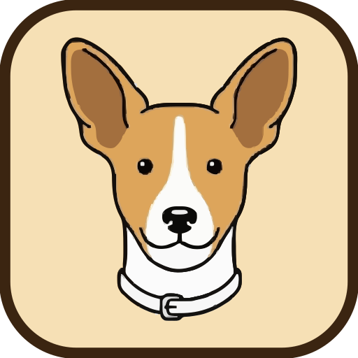

<p align="center">
  
</p>

<h1 align="center">Catarina</h1>

<p align="center">
  A local-first API client for Linux. Collections are plain JSON files you can
  version with Git.
</p>

<p align="center">
  
  
  
  
</p>


## Why Catarina

- **Collections are files.** One `.json` per request. Diff, branch and review them like code.
- **Secrets stay out of Git.** Tokens live in the system keyring; the request file stores only a `secretId`.
- **Native and light.** Qt 6 and Kirigami. No Electron, no account, no cloud.

## Features

- **Requests:** method, URL, params, headers, auth (Bearer, Basic, API key, inherited) and bodies (JSON, text, form, multipart).
- **Collections:** nested folders, drag and drop, rename, duplicate and move.
- **Variables:** `{{name}}` resolved from global to collection to request, with autocomplete, hover values and undefined-variable warnings.
- **Dynamic values:** `{{$randomUuid}}`, `{{$randomTimestamp}}`, `{{$randomInt}}`, `{{$randomBoolean}}` and more, generated per send.
- **Responses:** body, JSON tree, headers, cookies and a network timeline.
- **Workflow:** cURL import/export, history, command palette and remappable shortcuts.
- **Tabs:** preview, pin, reorder, reopen closed and restore the last session.
- **Data:** collections in the XDG Documents folder, settings in `~/.config/catarina`, secrets in the keyring.

## Install

The Flatpak manifest is in `packaging/io.github.guilhermelcosta.Catarina.yml`.
Flathub submission is pending.

From source:

```sh
./scripts/install.sh
```

This builds and installs to `~/.local` (`~/.local/bin/catarina`). To build and
run from the tree instead:

```sh
cmake -B build -DCMAKE_BUILD_TYPE=Release
cmake --build build -j
./build/bin/catarina
```

Dependencies, distro packages, Flatpak and tests: **[docs/BUILD.md](docs/BUILD.md)**.

## Development

```sh
ctest --test-dir build --output-on-failure
```

- Build and test details: [docs/BUILD.md](docs/BUILD.md)
- Architecture and data locations: [docs/ARCHITECTURE.md](docs/ARCHITECTURE.md)
- UI patterns: [docs/DESIGN.md](docs/DESIGN.md)
- Releases and branch model: [docs/RELEASING.md](docs/RELEASING.md)
- Agent and contributor rules: [AGENTS.md](AGENTS.md)

## Contributing

Read `AGENTS.md` before opening a pull request. Branch from `develop`, use
`<type>/<slug>` names, keep one behaviour per PR, run `ctest`, and never commit
secrets. UI changes follow `docs/DESIGN.md`.

## License

GPL-3.0-or-later. See [LICENSE](LICENSE).

## Credits

Built with [Qt](https://www.qt.io/) and [KDE Kirigami](https://invent.kde.org/frameworks/kirigami).
The example collection uses the public [DummyJSON](https://dummyjson.com/) API.
