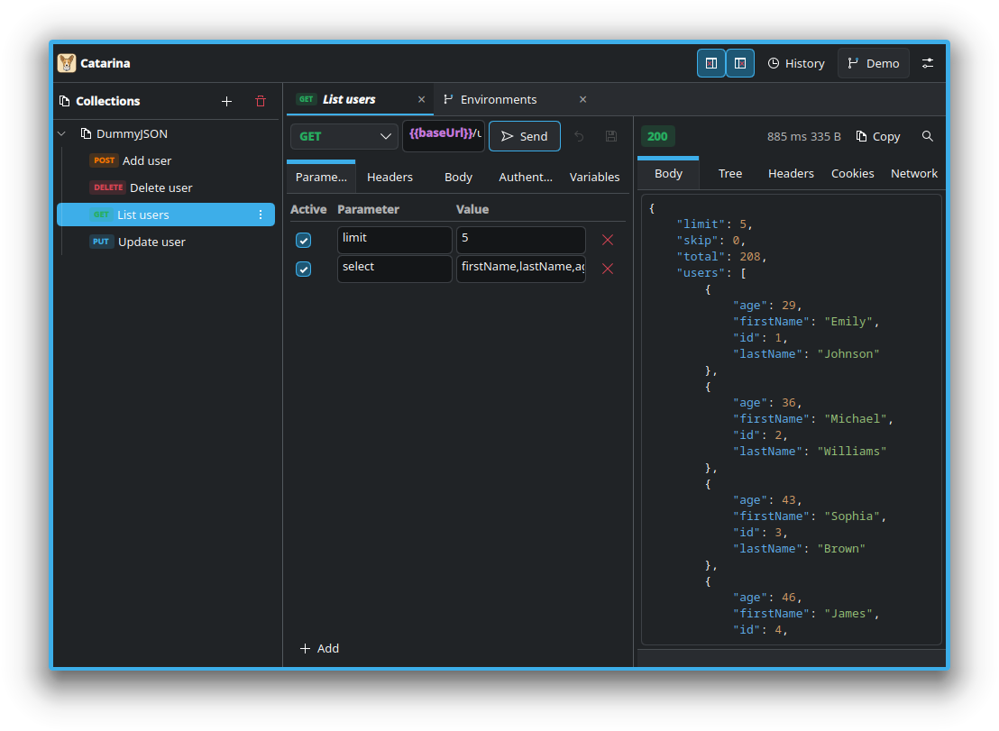

# Catarina


**Catarina is an offline API client for Linux** — collections and requests are versionable
`.json` files on your disk, not records in a remote database. Built with **Qt 6 / QML /
Kirigami**, with an English interface.



## Why another API client?

- **File-based, versionable collections.** Each request is a `.json` in
  the XDG Documents folder (usually `~/Documents/catarina`, localized names
  respected), configurable. Version it with `git`, review it in a diff, share it
  by folder, with no export/import.
- **Secrets out of the repository.** Passwords and tokens live in the **system keyring**
  (Secret Service/KWallet via QtKeychain); the versioned file only stores a `secretId`.
  With no keyring available, it falls back to a `0600` file outside the collections folder.
- **Truly scoped variables.** `{{name}}` resolved across the **global → collection →
  request** chain, with chained references, disabled variables, and per-collection scope.
- **Light and native.** No Electron. A single Qt/Kirigami binary.

## Features

- **Requests**: method, URL with querystring preview, params, headers (from the request and the
  collection), **auth** (Bearer / Basic / API Key / inherit from collection) and body
  (none / JSON / text / form-urlencoded / **multipart with file**).
- **Nested collections** with drag-and-drop, rename, duplicate, and move; **indent guides**
  (VS Code style) in the tree.
- **Variables** `{{variable}}` with autocomplete, hover showing the value, and undefined-variable
  warning — in the URL, headers, body, auth, and tables.
- **Dynamic variables** `{{$randomUuid}}`, `{{$randomTimestamp}}`, `{{$randomIsoTimestamp}}`,
  `{{$randomInt}}`, `{{$randomBoolean}}`, `{{$randomDecimal}}`, `{{$randomName}}`, `{{$randomEmail}}`
  generated on each send (all names carry the `$random` prefix).
- **Global environments**, scoped per collection or to "all".
- **Response**: body, **JSON tree**, headers, cookies, and a **Network tab** (timeline).
- **VS Code-style tabs**: transient preview, pin/unpin, reorder, reopen closed, and
  **restore session**.
- **Import/export cURL**, send **history**, and a **command palette** (`Ctrl+K`).
- **Remappable shortcuts** in settings.
- **Example collection** (DummyJSON) created on first use — shows the GET/POST/PUT/DELETE flows,
  parameters, inherited auth, and **dynamic variables** (`Add user` uses `{{$randomInt}}` and
  `{{$randomEmail}}`).

## Installation

### Dependencies

- **Qt 6.5+** — `Core`, `Gui`, `Qml`, `Quick`, `QuickControls2`, `Network`
- **Extra CMake Modules (ECM) 6**
- **KF6 Kirigami**
- **QtKeychain** (optional) — enables the OS keyring; without it, secrets go to a `0600` file

<details>
<summary>Package names by distro</summary>

**Fedora / KDE**
```sh
sudo dnf install cmake gcc-c++ \
    extra-cmake-modules \
    qt6-qtbase-devel qt6-qtdeclarative-devel qt6-qtquickcontrols2-devel \
    kf6-kirigami-devel qtkeychain-qt6-devel
```

**Arch**
```sh
sudo pacman -S cmake extra-cmake-modules \
    qt6-base qt6-declarative qt6-quickcontrols2 kirigami qtkeychain-qt6
```

**Debian/Ubuntu**
```sh
sudo apt install cmake g++ extra-cmake-modules \
    qt6-base-dev qt6-declarative-dev qt6-quickcontrols2-dev \
    kirigami6-dev libqt6keychain1
```
</details>

### Build and run

```sh
cmake -B build -DCMAKE_BUILD_TYPE=Release
cmake --build build -j
./build/bin/catarina
```

### Flatpak

The manifest at `packaging/io.github.guilhermelcosta.Catarina.yml` already includes QtKeychain:

```sh
flatpak run --command=flathub-build org.flatpak.Builder --install \
    packaging/io.github.guilhermelcosta.Catarina.yml
```

### Install to the system

```sh
cmake --install build
```

## Tests

```sh
ctest --test-dir build --output-on-failure
```

| Target | Covers |
|---|---|
| `check_storage` | pure request logic, variable resolution, secrets, disk persistence, seed |
| `check_http` | real HTTP integration with a local server (response, error, cancellation, multipart) |
| `tst_components` | QML components and JS logic (QtQuickTest) |
| `tst_app` | screen behavior: tabs, session, editing/dirty, deletion, import, guides |
| `check_highlighter` | JSON syntax highlighting |
| `qml_smoke` | the app loads without QML errors |

The tests are **hermetic** (temporary directory, touching neither your data nor the real keyring).

## Project structure

```
src/
  core/       pure logic: request schema, variable substitution, resolution
  storage/    I/O behind injection: collections, environments, history, secrets
  net/        request assembly (RequestBuilder) and sending (HttpClient)
  backend.*   Q_INVOKABLE facade exposed to QML
  settings.*  preferences;  highlighter.*  {{var}}/JSON highlighting;  main.cpp
qml/
  Main.qml        window + wiring (shell)
  AppController   state and orchestration (non-visual QtObject)
  screens/        screens (RequestEditor, ResponsePane, CollectionScreen, ...)
  dialogs/        modals and popups
  js/, Util.js, Strings.js   pure logic and texts
tests/            check_*, tst_* (ctest)
docs/DESIGN.md    visual and component standards
```

**Where the data lives**

| What | Where |
|---|---|
| Collections/requests | XDG Documents folder, `catarina/` (configurable) |
| Preferences | `~/.config/catarina/catarina.ini` |
| Secrets | OS keyring or `~/.local/share/catarina/secrets.json` (`0600`) |
| History | `~/.local/share/catarina/history.json` |

## Contributing

1. Read **[`AGENTS.md`](AGENTS.md)** (rules for agents/contributors) and
   **[`docs/DESIGN.md`](docs/DESIGN.md)** before touching the UI — the components and spacing
   follow a single pattern.
2. Reuse the existing components (`KvTable`, `SaveBar`, `EmptyState`, ...) instead of creating
   local ones; if a new pattern emerges, **document it in DESIGN.md**.
3. Run `ctest` before opening the PR. Keep history in small, descriptive commits
   (`feat:`, `fix:`, `refactor:`, `test:`, `docs:`).

## License

GPL-3.0-or-later. See [`LICENSE`](LICENSE).

## Credits

Built with [Qt](https://www.qt.io/) and [KDE Kirigami](https://invent.kde.org/frameworks/kirigami).
The example collection uses the public [DummyJSON](https://dummyjson.com/) API.
